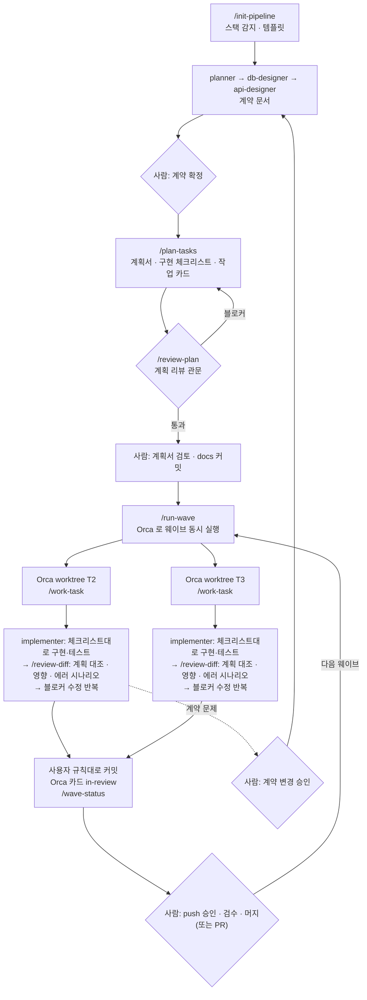

# dev-pipeline

AI 에이전트 여러 개에게 **여러 기능을 동시에** 맡기는 개발 파이프라인 플러그인입니다. 구현 전에 계획서와 구현 체크리스트를 만들어 리뷰를 통과시키고, [Orca](https://github.com/stablyai/orca) 로 worktree 와 Claude 를 자동으로 띄워 각자 구현 → 테스트 → 리뷰 → 블로커 수정까지 끝낸 뒤 사람에게 검수를 넘깁니다.

흐름: **설계(계약 문서) 확정 → 계획서 · 구현 체크리스트 → 계획 리뷰 → 웨이브마다 Orca 로 동시 실행 → 각자 코드 리뷰 통과 → 사용자 규칙대로 커밋 · push 는 확인 → 사람이 검수·머지 → 다음 웨이브**

특정 언어 · 프레임워크 · DB 에 묶여 있지 않습니다. 프로젝트마다 스택을 감지하거나 사용자에게 고르게 해서 `CLAUDE.md` 에 기록하고, 모든 에이전트가 그 기록을 기준으로 움직입니다.

- 버전: 0.3.0
- 구성: 스킬 8 (사용자 실행 7 + 자동 규칙 1) · 에이전트 6 · 훅 2 (쓰기 위치 제한 · 에이전트 진행 기록) · 템플릿 6
- 리뷰 관문 두 번: 구현 전 **계획 리뷰**(계획이 목적에 맞는지, 체크리스트대로 하면 끝나는지) · 구현 후 **코드 리뷰**(계획대로 됐는지, 다른 기능에 주는 영향, 에러 시나리오)
- 리뷰어: Claude(reviewer 에이전트), Codex(Codex CLI), 둘 다 중에서 선택. GitHub PR 에서는 `@codex review` 로 같은 기준의 리뷰

---

## 1. 해결하는 문제

에이전트 하나로 개발하면 목수 한 명이 집을 짓는 것과 같아서 느리지만 앞뒤가 맞습니다. 빨리 하려고 여러 명을 동시에 붙이면:

| 증상 | 원인 | dev-pipeline 의 해법 |
| --- | --- | --- |
| A 는 `user_id`, B 는 `userId` | 서로 무엇을 정했는지 모름 | 모두 같은 **계약 문서**(요구사항·스키마·API 명세)를 보고 만든다 |
| 같은 파일을 둘이 고쳐 머지 충돌 | 작업을 나눌 때 파일을 안 봄 | `/plan-tasks` 가 **파일이 겹치지 않게** 나눈다 |
| 구현하다 API 를 맘대로 바꿈 | 설계도를 고칠 수 있음 | 구현 에이전트는 `docs/` 를 **고칠 수 없게 잠겨** 있다 |
| 계획이 애초에 목적과 어긋남 | 계획을 검사하지 않고 바로 구현 | 구현 전에 **계획 리뷰**를 통과해야 띄운다 |
| "다 됐다" 는데 빠진 게 있음 | 만든 사람이 스스로 검사 | **다른 에이전트(Claude · Codex)가 체크리스트와 대조**하고, 영향·에러 시나리오까지 본 뒤 블로커가 0 일 때까지 반복 |
| worktree 열고 지시 붙여넣기가 번거로움 | 병렬 준비가 수작업 | `/run-wave` 가 **Orca 로 한 번에 띄운다** |

## 2. 설치

```bash
claude plugin marketplace add HiSoo38/claude-toolkit
claude plugin install dev-pipeline@claude-toolkit
```

세션 안에서는 `/plugin install dev-pipeline@claude-toolkit`, 이미 열린 세션에는 `/reload-plugins`. 확인: `claude plugin details dev-pipeline`

필요한 것:

| 도구 | 쓰는 곳 | 없으면 |
| --- | --- | --- |
| git | worktree, 리뷰 | 필수 |
| [Orca](https://github.com/stablyai/orca) 앱 (CLI `orca` 포함) | `/run-wave`, `/wave-status` | 작업마다 worktree 를 직접 만들고 `/work-task` 를 직접 실행 |
| Python 3 (`python3` 또는 `python`) | 쓰기 위치 제한 훅 | 훅이 동작하지 않고 프롬프트 지시만 남음 |
| Codex CLI (`npm install -g @openai/codex` → `codex login`) | Codex 리뷰 | Claude 리뷰만 |
| `gh` CLI | `/plan-tasks` 의 GitHub 이슈 생성 | 이슈 생성만 못 함 |

환경변수나 비밀값은 필요 없습니다.

**권한 설정**: Orca 가 띄운 Claude 들이 매번 권한을 물으면 자동 진행이 멈춥니다. Claude Code 기본 권한 모드를 `auto` 로 두거나(`/permissions` 또는 settings 의 `permissions.defaultMode`), 프로젝트 `.claude/settings.json` 에 빌드·테스트 명령과 `orca worktree set *` 를 허용해 두세요.

## 3. 빠른 시작

명령의 정식 이름은 `/dev-pipeline:<이름>` 입니다. 다른 플러그인과 겹치지 않으면 `/init-pipeline` 처럼 짧게 써도 됩니다.

```text
1. /dev-pipeline:init-pipeline
   → 스택 감지(빈 폴더면 선택지로 질문) → CLAUDE.md, AGENTS.md, docs/ 계약 문서 틀 생성

2. 설계 (순서대로, 사람이 확정)
   "planner 에이전트로 요구사항 정리해줘: <만들 서비스 설명>"  → 질문에 답하고 확정
   "db-designer 로 스키마 만들어줘"                            → 확정
   "api-designer 로 API 명세 써줘"                            → 확정

3. /dev-pipeline:plan-tasks
   → docs/tasks/plan.md (계획서) · checklist.md (구현 체크리스트) · T1.md … (작업 카드)
   → 이어서 계획 리뷰 → docs/tasks/plan-review.md (통과해야 다음 단계)

4. 계획서를 검토하고, 계약 문서와 docs/tasks/ 를 main 에 커밋 (사람)

5. /dev-pipeline:run-wave
   → 웨이브 1 의 작업마다 Orca worktree + Claude 를 동시에 띄움
   → 각 Claude: 구현 → 테스트 → 리뷰 → 블로커 수정 → 커밋(사용자 규칙) → push 할지 질문 → Orca 카드 "in-review"

6. /dev-pipeline:wave-status
   → 어떤 작업이 리뷰 통과 / 중단 / 진행 중인지 한 표로

7. 리뷰 통과·커밋된 작업 브랜치를 검수 → 머지 또는 PR (사람)

8. 웨이브가 다 머지되면 다시 /dev-pipeline:run-wave → 다음 웨이브
```

기존 프로젝트도 같습니다. `/init-pipeline` 이 빌드 파일을 보고 스택을 감지하고, 이미 있는 `CLAUDE.md` 는 덮어쓰지 않고 "건너뛰기 / 빠진 섹션만 추가 / 덮어쓰기" 를 묻습니다.

## 4. 커맨드

| 커맨드 | 어디서 | 하는 일 |
| --- | --- | --- |
| `/init-pipeline [경로]` | 프로젝트 루트, 처음 한 번 | 스택 감지 · 템플릿 설치 · CLAUDE.md 기록 |
| `/plan-tasks [추가 지시]` | 메인 체크아웃 | 계약 문서 → 계획서 · 구현 체크리스트 · 작업 카드 → 계획 리뷰 |
| `/review-plan [claude\|codex\|both] [--allow-draft]` | 메인 체크아웃 | 구현 전 계획 리뷰 (`/plan-tasks` 가 자동 실행, 계획을 고친 뒤 다시) |
| `/run-wave [웨이브 \| T번호…] [--yes]` | 메인 체크아웃 | 다음 웨이브를 Orca 로 동시 실행 |
| `/wave-status` | 메인 체크아웃 | 작업별 진행 상황과 사람이 할 일 |
| `/work-task T<번호>` | 작업 worktree | 작업 하나를 리뷰 통과까지 (`/run-wave` 가 자동 실행) |
| `/review-diff [claude\|codex\|both] [--uncommitted] [기준]` | 작업 worktree | 변경 리뷰 (`/work-task` 가 자동 실행, 직접도 가능) |

### `/init-pipeline`

- 근거 파일(`build.gradle`, `pom.xml`, `package.json`, `requirements.txt`, `pyproject.toml`, `go.mod`, `Cargo.toml`, `application.yml/properties`, `.env.example`, `docker-compose.yml` 등)에서 언어 · 프레임워크 · 빌드 도구 · DB · 테스트 도구를 찾아 **근거와 함께** 보여주고 확인을 받습니다.
- 감지 실패나 빈 프로젝트면 항목별 선택지로 묻습니다 (기타 직접 입력 가능).
- 스키마 형식: 관계형 DB → `docs/schema.sql`, 문서형 DB 나 ORM 모델 중심 → `docs/schema.md`, DB 없음 → 만들지 않음.
- `.env` 는 읽지 않습니다 (`.env.example` 만). 소스 코드와 git 상태는 건드리지 않습니다.

### `/plan-tasks`

- 계약 문서를 읽고 **파일 범위가 겹치지 않는** 작업으로 나눕니다. 여러 기능이 같이 쓰는 파일(라우터 등록, 의존성 파일, 공통 타입)은 "공통 모듈" 작업으로 떼어 먼저 하게 합니다.
- 의존 관계로 **웨이브**를 나눕니다. 같은 웨이브의 작업은 동시에 실행됩니다.
- 결과는 세 문서로 남습니다 (`docs/tasks/`):

  | 문서 | 내용 |
  | --- | --- |
  | `plan.md` 계획서 | 목표와 범위, 구현 방식, **작업 간 공통 약속**(뒤 작업이 앞 작업 결과를 쓰는 함수·타입 모양), 작업·웨이브 표, 공유 파일 소유, 테스트 전략, 위험과 대응 |
  | `checklist.md` 구현 체크리스트 | 작업마다 순서대로 따라 하면 구현이 끝나는 항목 (`T2-1`, `T2-2` …: 구현 → 테스트 → 검증). implementer 가 이 순서로 구현하고, 리뷰어가 항목별로 대조한다 |
  | `T<번호>.md` 작업 카드 | 작업 하나의 담당 파일 범위, 범위 밖, 지킬 공통 약속, 완료 조건 |

- 체크리스트는 계획 문서라 직접 체크하지 않습니다. 항목별 결과는 작업마다 `docs/tasks/results/T<번호>.md` 에 남습니다 (여러 작업이 한 파일을 동시에 고치면 머지 충돌이 나기 때문).
- 브랜치명은 `t<번호>-<슬러그>` (Orca 가 worktree 이름을 그대로 브랜치명으로 써서 슬래시를 쓰지 않습니다).
- 끝에 **계획 리뷰**(`/review-plan`)를 자동으로 돌리고, 카드로 고칠 수 있는 블로커는 고쳐서 다시 리뷰합니다.
- 마지막으로 GitHub 이슈로 만들지 묻습니다 (카드 + 체크리스트가 이슈 본문, 번호는 `issues.md`).

예 (할 일 API):

```text
| 작업 | 제목                         | 웨이브 | 의존           | 브랜치                 |
| T1   | 공통 모듈 (설정·에러·DB·앱 틀)  | 1      | 없음           | t1-common-foundation |
| T2   | 할 일 생성·목록 조회           | 2      | T1             | t2-todo-collection   |
| T3   | 할 일 완료 처리·삭제           | 2      | T1             | t3-todo-item         |
| T4   | 앱 조립·진입점·통합 테스트      | 3      | T2, T3         | t4-app-wiring        |
```

### `/review-plan` — 구현 전 관문

plan-reviewer 에이전트(Claude) · Codex · 둘 다가 계획을 검사합니다.

| 관점 | 보는 것 |
| --- | --- |
| 목적 충족 | 요구사항의 목표 · 역할마다 그걸 이루는 기능이 있는가, 목표와 상관없는 기능은 없는가 |
| 계약끼리 일치 | 요구사항 ↔ 스키마 ↔ API 명세가 서로 맞는가 |
| 작업 카드 | 모든 기능이 정확히 한 카드에 있는가, 파일 범위가 안 겹치는가, 의존 순서가 맞는가 |
| 구현 체크리스트 | 완료 조건마다 채우는 항목이 있는가, **순서대로 따라 하면 정말 끝나는가**, 테스트가 에러 코드까지 덮는가 |
| 코드 구조 | 이미 있는 공통 코드를 새로 만들게 짜이지 않았는가, 공통 작업 분리 · 파일 구성 |
| 위험 | 동시성 · 데이터 정합성 · 대량 데이터 등 |

결과는 `docs/tasks/plan-review.md` 에 판정, 추적표(목표 → 기능 → 스키마 → API → 카드 → 체크리스트 항목), 그리고 **검사한 문서의 지문**과 함께 남습니다. `/run-wave` 는 판정이 통과이고 그 뒤 문서가 바뀌지 않았을 때만 작업을 띄웁니다 (`--yes` 로도 건너뛸 수 없음).

리뷰어가 지나치게 엄격하다고 판단되면, 고치지 않고 넘길 블로커를 `plan-review.md` 맨 아래 **"사람 판단"** 표에 번호 · `기각` · 이유로 적으세요. `/run-wave` 는 기각된 블로커를 해결된 것으로 보고, 띄울 때 목록을 함께 보여줍니다.

테스트에서 실제로 잡은 예: "스키마는 id 를 BIGINT 로 받는데 응답은 JSON 숫자라 2^53 을 넘으면 값이 틀어진다" (계약 결함), "계약에 적힌 '모르는 쿼리 파라미터는 무시' 에 대응하는 테스트 항목이 없다" (체크리스트 누락).

### `/run-wave`

메인 체크아웃(기준 브랜치)에서 실행합니다.

1. 사전 확인: Orca 실행 중, 기준 브랜치, **계약 문서와 `docs/tasks/` 가 커밋돼 있는지** (worktree 는 커밋된 상태에서 만들어지므로), **계획 리뷰 통과**, 계약이 초안이면 초안 진행 승인(`--allow-draft`), 레포가 Orca 에 등록돼 있는지.
2. 다음에 띄울 작업을 고릅니다: 대기 작업이 남은 가장 낮은 웨이브에서, 의존 작업이 모두 **머지된** 작업. 동시 작업 수(기본 3)를 넘으면 나머지는 다음에 띄웁니다.
3. 띄울 목록을 보여주고 확인을 받은 뒤(`--yes` 면 바로), 작업마다 실행합니다:
   ```bash
   orca worktree create --repo "path:<루트>" --name <브랜치> --no-parent --base-branch main \
     --agent claude --prompt "/dev-pipeline:work-task T<번호>"
   ```
4. 띄우고 끝납니다. 기다리지 않습니다. 진행은 Orca 화면이나 `/wave-status` 로 봅니다.

인자로 범위를 정할 수 있습니다: `/run-wave 2` (웨이브 2), `/run-wave T3 T4` (특정 작업).

### `/work-task T<번호>` — 각 worktree 의 Claude 가 하는 일

| 단계 | 하는 일 | Orca 카드 |
| --- | --- | --- |
| 준비 | CLAUDE.md, 작업 카드, 체크리스트의 그 작업 섹션, 계획서의 공통 약속 읽기 | `in-progress` · "T2 구현 중" |
| 구현 | `implementer` 에이전트에게 카드 + 체크리스트 + 공통 약속을 주고, 체크리스트 순서대로 구현 + 이 작업 테스트 통과 | |
| 리뷰 | `/review-diff` (설정된 리뷰어, 작업 중 변경 포함): 체크리스트 항목별 대조 · 영향 분석 · 에러 시나리오 | "T2 리뷰 중" |
| 수정 | 블로커가 있으면 implementer 가 블로커만 고치고 다시 리뷰 (기본 최대 2회) | "블로커 n건 수정 중 (1/2)" |
| 통과 | | `in-review` · "리뷰 통과 · 블로커 0 · 테스트 통과" · 읽지 않음 표시 |
| 커밋 | 사용자의 커밋 규칙대로 작업 브랜치에 커밋 (담당 범위 + 결과 기록만) | "리뷰 통과 · 커밋 abc123 · push 대기" |
| push 확인 | "T2 브랜치를 원격에 push 할까요?" 를 그 탭에서 묻고, 승인하면 push | |
| 중단 | 계약 문제, 범위 밖 수정 필요, 블로커가 안 풀림 | "중단: …" 또는 "블로커 n건 남음" · 읽지 않음 표시 |

- 코드는 직접 고치지 않고 implementer 에게 맡깁니다. 그래야 `docs/` 보호 훅이 걸립니다.
- **커밋은 각 사용자의 규칙대로** 합니다. 세션에 로드된 사용자 지시(전역 `~/.claude/CLAUDE.md`, 프로젝트 `CLAUDE.md`, `CLAUDE.local.md`)에 커밋 규칙이 있으면 형식 · 언어 · 나누는 기준까지 그대로 따르고, 없을 때만 기본 형식(`type(scope): 요약` + 이유 · 근거)을 씁니다. 기준 브랜치에는 커밋하지 않고, 훅을 건너뛰지 않습니다.
- **push 는 항상 사용자에게 묻습니다.** 사용자에게 push 규칙이 있으면 그것도 따릅니다. 머지와 PR 은 사람이 합니다.
- 커밋을 사람이 하고 싶으면 CLAUDE.md 설정 `작업 브랜치 커밋: 사람`. push 를 아예 안 하려면 `push: 안 함`.
- 다른 작업과 동시에 돌기 때문에 테스트는 이 작업의 테스트 파일만, 워커 1개로 돌립니다.
- 항목별 결과를 `docs/tasks/results/T<번호>.md` 에 남깁니다 (체크리스트 항목마다 완료/못 함과 근거, 완료 조건, 최종 리뷰 요약). 코드 변경과 함께 커밋하면 됩니다.
- 마지막에 결과 보고(바꾼 파일, 테스트 결과, 리뷰 회차, 남은 권장 사항, 사람이 할 일)를 그 탭에 남깁니다.

### `/wave-status`

```text
| 작업 | 제목       | 웨이브 | 상태           | Orca 코멘트                          | 변경 파일 |
| T1   | 공통 모듈   | 1      | 머지됨          |                                     | -        |
| T2   | 생성·목록   | 2      | 검수 대기       | 리뷰 통과 · 블로커 0 · 테스트 통과       | 6        |
| T3   | 완료·삭제   | 2      | 사람 확인 필요   | 중단: 계약 변경 필요 — 정렬 기준 미정     | 3        |

사람이 할 일
- 검수 대기: T2 — C:/Users/me/orca/workspaces/app/t2-todo-collection 에서 확인 → 커밋 → 머지
- 사람 확인 필요: T3 — 그 탭의 마지막 보고 확인
다음 웨이브
- 웨이브 3: T4 — T2, T3 가 머지되면 /run-wave
```

### `/review-diff`

| 리뷰어 | 누가 보나 | 방식 |
| --- | --- | --- |
| `claude` | `dev-pipeline:reviewer` 에이전트 | diff 를 넘겨 받음. 도구가 Read/Glob/Grep 뿐이라 파일 수정 불가 |
| `codex` | Codex CLI | `codex exec -s read-only` — 읽기 전용 샌드박스에서 직접 git diff 와 계약 문서를 읽음 |
| `both` | 둘 다 동시에 | 결과를 합쳐 항목마다 `[둘 다]` / `[Claude]` / `[Codex]`. 등급이 다르면 높은 쪽 |

- 기본 리뷰어는 CLAUDE.md "파이프라인 설정" 의 `리뷰어` (템플릿 기본 `both`). Codex 를 쓸 수 없으면 `both` 는 Claude 만으로 진행하고 알립니다.
- 두 리뷰어 모두 같은 기준을 씁니다: 계약 문서 + 구현 계획(체크리스트 · 카드 · 공통 약속) + `AGENTS.md` 의 "Review guidelines".
- 보는 것: **계획 일치**(체크리스트 항목·완료 조건을 하나씩 대조), 계약 일치, **영향 분석**(바뀐 함수·타입·응답을 쓰는 다른 기능이 깨지는지), **에러 시나리오**(빈 값·경계값·잘못된 입력, 없는 대상, 중복·동시 요청, DB 실패), 예외처리, 트랜잭션, 보안, 성능, 테스트 누락, **코드 구조**(기존 공통 코드를 두고 새로 만든 중복은 블로커, 긴 파일·과분리·스타일 차이는 권장), 작업 범위.
- 결과: **블로커 / 권장 / 사소함** + 계획 대조 표 + 영향 분석 + 에러 시나리오 표, 판정(블로커 0 이면 통과).

#### GitHub PR 에서 Codex 리뷰 받기

PR 을 올린다면 GitHub 에서도 Codex 리뷰를 받을 수 있습니다 (OpenAI 쪽 설정).

1. ChatGPT 의 Codex 설정에서 저장소를 연결하고 **Code review** 를 켭니다.
2. PR 에 `@codex review` 댓글을 달면 리뷰가 달립니다. **Automatic reviews** 를 켜면 PR 마다 자동으로.
3. Codex 는 `AGENTS.md` "Review guidelines" 를 기준으로 리뷰하므로, 로컬 리뷰와 같은 기준입니다.

자세한 설정: [Codex code review in GitHub](https://developers.openai.com/codex/integrations/github)

### 자동 규칙: `pipeline-workflow`

커맨드가 아니라, 기능 구현을 시작하거나 계약 문서를 바꾸려 할 때 Claude 가 스스로 불러오는 규칙입니다. 계약 확정 전 구현 금지, 작업 하나 = worktree 하나, 구현·리뷰 분리, 계약 변경은 사람 승인, 띄우기는 자동·머지는 사람, 리뷰 관문 두 번(계획 · 코드).

## 5. 에이전트

모든 에이전트는 시작할 때 프로젝트 `CLAUDE.md` 의 "기술 스택" 과 계약 문서를 읽고, 기술 스택이 비어 있으면 작업하지 않고 `/init-pipeline` 을 안내합니다.

| 에이전트 | 입력 → 출력 | 도구 (실제 허용 목록) | 쓰기 제한 (훅) |
| --- | --- | --- | --- |
| `planner` | 사용자 요구 → `docs/requirements.md` | Read, Glob, Grep, Write, Edit | `docs/` 밖 금지 |
| `db-designer` | requirements → `docs/` 스키마 | Read, Glob, Grep, Write, Edit | `docs/` 밖 금지 |
| `api-designer` | requirements + 스키마 → `docs/api-spec.md` | Read, Glob, Grep, Write, Edit | `docs/` 밖 금지 |
| `plan-reviewer` | 계약 문서 + 계획서 · 체크리스트 · 카드 → 계획 리뷰 | Read, Glob, Grep | 전부 금지 |
| `implementer` | 작업 카드 + 체크리스트 → 코드 + 테스트 | Read, Glob, Grep, Write, Edit, Bash | `docs/` 금지 |
| `reviewer` | 변경 + 계획 → 코드 리뷰 (계획 대조 · 영향 · 에러 시나리오) | Read, Glob, Grep | 전부 금지 |

문서 담당 세 에이전트에는 Bash 가 없어서 셸로 우회할 수 없습니다. implementer 는 빌드·테스트 때문에 Bash 가 있으므로 `docs/` 보호는 Write/Edit 차단 + 프롬프트 지시입니다.

호출 예:

```text
planner 에이전트로 요구사항 정리해줘. 동네 도서관 대출 관리 서비스고, 회원은 책을 검색하고 대출 · 반납 · 연장할 수 있어.
db-designer 에이전트로 docs/requirements.md 기준 스키마 만들어줘.
api-designer 에이전트로 API 명세 써줘.
```

plan-reviewer, implementer, reviewer 는 보통 `/review-plan` · `/work-task` · `/review-diff` 가 부릅니다. 직접 부르려면 `@agent-dev-pipeline:implementer` 처럼 지목합니다.

## 6. 전체 흐름



**사람이 하는 일은 다섯 가지입니다**: 계약 문서 확정, 계획 리뷰 블로커 판단과 계획서 검토, 계획 문서 커밋과 `/run-wave` 실행, push 승인, 리뷰 통과 작업의 검수·머지.

## 7. 진행 상황 보기

에이전트 여러 개가 동시에 돌기 때문에, 지금 **어떤 에이전트가 무엇을 하고 있는지** 세 군데서 볼 수 있습니다.

| 어디서 | 무엇이 보이나 |
| --- | --- |
| **Orca 앱** 왼쪽 목록 → 레포 → 작업 이름 | 그 작업의 Claude 화면 그대로. `/run-wave` 가 띄운 작업에는 읽지 않음 점이 붙고, 첫 작업 탭은 앞으로 띄워 줍니다. 카드 코멘트에 지금 단계("T2 구현 중", "T2 리뷰 중", "블로커 1건 수정 중 (1/2)")가 나옵니다 |
| **진행 로그** `tail -f <레포>/.git/dev-pipeline/progress.log` | 모든 작업의 에이전트 시작·끝이 한 파일에 시각 순으로. 경로는 `/run-wave` 보고에 실제 값으로 나옵니다 |
| **`/dev-pipeline:wave-status`** | 작업별 상태 표 + 진행 로그의 최근 줄 + 사람이 할 일 |

진행 로그 예:

```text
2026-10-27 14:40  [main]                웨이브 2 시작: T2, T3
2026-10-27 14:40  [t2-todo-collection]  implementer 시작 — T2 생성·목록 구현
2026-10-27 14:40  [t3-todo-item]        implementer 시작 — T3 완료·삭제 구현
2026-10-27 14:47  [t2-todo-collection]  implementer 끝 (7분) — T2 결과: 완료 (빌드·테스트 통과)
2026-10-27 14:47  [t2-todo-collection]  reviewer 시작 — T2 변경 리뷰
2026-10-27 14:47  [t2-todo-collection]  codex 리뷰 시작
2026-10-27 14:51  [t2-todo-collection]  codex 리뷰 끝 — 블로커 0
2026-10-27 14:52  [t2-todo-collection]  T2 in-review 리뷰 통과 · 블로커 0 · 테스트 통과
```

- Claude 에이전트(planner · plan-reviewer · implementer · reviewer 등)의 시작·끝은 **플러그인 훅이 자동으로** 기록합니다 (`hooks/log_agents.py`). 에이전트가 기록을 잊어도 빠지지 않습니다.
- Codex 리뷰와 작업 단계(시작 · 리뷰 중 · 통과 · 중단)는 각 커맨드가 기록합니다.
- 로그는 git 폴더 안(`.git/dev-pipeline/`)에 있어 커밋되지 않고, 모든 worktree 가 같은 파일에 씁니다.

## 8. 코드 구조 원칙

템플릿 `CLAUDE.md` 에 "코드 구조 원칙" 섹션이 들어 있고, 계획 · 구현 · 리뷰가 모두 이 기준을 씁니다. 프로젝트 문서라 팀이 같이 보고 고칠 수 있습니다.

| 원칙 | 내용 |
| --- | --- |
| 공통화 | 여러 곳에 쓸 것은 공통 모듈로. **이미 있으면 가져다 쓴다** — 새로 만들기 전에 "공용 코드 위치" 를 먼저 찾는다 |
| 분리 | 분리할 수 있는 것은 발견한 시점에 분리한다 (담당 범위 안에서) |
| 과분리 금지 | 관련된 것이 흩어지지 않게, 너무 잘게 쪼개지 않는다 |
| 판단 잣대 | 다른 팀원에게 넘겼을 때 코드만 보고 이해되는가 |
| 기존 스타일 | 주변 코드의 구조 · 이름 · 관용구를 그대로 따른다 |
| 확장성 | 다음 기능이 같은 자리에 붙을 수 있게 |
| 점검 | 작업 끝에 점검하고 결과를 먼저 보고. 멀쩡한 기존 구조를 근거 없이 갈아엎지 않는다 |

적용되는 곳: `/plan-tasks` 가 기존 공통 코드를 먼저 찾아 계획서 "재사용할 기존 코드" 에 적고 → 계획 리뷰가 중복 계획을 잡고 → implementer 가 만들기 전에 찾아 쓰고 보고에 점검 결과를 남기고 → 코드 리뷰가 중복(블로커) · 구조(권장)를 보고 → `results/T<번호>.md` 에 "코드 구조 점검" 이 남습니다.

## 9. 설정 (프로젝트 CLAUDE.md "파이프라인 설정")

| 항목 | 기본값 | 쓰는 곳 |
| --- | --- | --- |
| 리뷰어 | `both` | `/review-plan`, `/review-diff` |
| 동시 작업 수 | 3 | `/run-wave` |
| 리뷰 수정 횟수 | 2 | `/work-task` |
| 기준 브랜치 | `main` | 전부 |
| 작업 브랜치 커밋 | `자동` | `/work-task` — `사람` 이면 커밋하지 않고 제안 메시지만 |
| push | `물어봄` | `/work-task` — `안 함` 이면 묻지 않고 명령만 알려 줌 |

## 10. 스택 자동 감지와 수동 선택

- 감지 규칙과 선택지는 데이터 파일 [`skills/init-pipeline/stack-catalog.md`](./skills/init-pipeline/stack-catalog.md) 에 표로 있습니다. 새 스택은 표에 한 줄 추가하면 됩니다.
- 수동 선택: 확인 질문에서 "일부 수정" 또는 "처음부터 직접 선택". 나중에 바꾸려면 CLAUDE.md "기술 스택" 표를 직접 고치거나 `/init-pipeline` 을 다시 실행합니다.
- 에이전트·커맨드 프롬프트에는 특정 언어·프레임워크·DB 이름이 없습니다. 판단 기준은 언제나 프로젝트의 `CLAUDE.md` 입니다.

## 11. 커스터마이징

플러그인 파일을 고치려면 레포를 클론해 로컬 마켓플레이스로 추가하세요 (`claude plugin marketplace add ./claude-toolkit`). 설치된 캐시 사본을 고치면 업데이트 때 사라집니다.

| 바꾸고 싶은 것 | 위치 |
| --- | --- |
| 프로젝트에 깔리는 문서 틀 | `templates/` |
| 지원 스택, 감지 규칙, 선택지, 기본 명령 | `skills/init-pipeline/stack-catalog.md` |
| 계획서 · 구현 체크리스트 · 작업 카드 형식 | `skills/plan-tasks/SKILL.md` 2~4단계 |
| 계획 리뷰 관점 | `agents/plan-reviewer.md`, `skills/review-plan/codex-plan-review-prompt.md` |
| 작업자 절차 (구현·리뷰·수정 순서, Orca 카드 문구) | `skills/work-task/SKILL.md` |
| 띄우는 방식 (Orca 명령, 에이전트 종류) | `skills/run-wave/SKILL.md` 3단계 |
| 에이전트 역할 · 리뷰 관점 · 허용 도구 | `agents/<이름>.md` |
| 쓰기 위치 제한 | `hooks/guard_paths.py` 상단 상수 |
| 진행 로그 형식 · 위치 | `hooks/log_agents.py` |
| Codex 리뷰 지시문 · 출력 형식 | `skills/review-diff/codex-review-prompt.md` |
| 리뷰 기준 (Claude · Codex · GitHub PR 공통) | 프로젝트 `AGENTS.md` "Review guidelines" |
| 코드 구조 원칙 · 공용 코드 위치 | 프로젝트 `CLAUDE.md` "코드 구조 원칙", "코딩 컨벤션" (템플릿: `templates/CLAUDE.md`) |

한 프로젝트에서만 다르게 하려면 그 프로젝트의 `CLAUDE.md` 에 적으세요. 모든 에이전트가 매번 읽습니다.

## 12. FAQ / 문제 해결

**`/run-wave` 가 "계획 리뷰가 필요합니다" / "리뷰 뒤 계획이 바뀌었습니다" 라며 멈춰요.**
구현 전 관문입니다. `/dev-pipeline:review-plan` 을 실행해 통과시키세요. 계획서·체크리스트·카드·계약 문서를 고치면 지문이 바뀌어 다시 리뷰해야 합니다. 고치지 않고 넘길 블로커는 `plan-review.md` 의 "사람 판단" 표에 기각과 이유를 적습니다.

**`/run-wave` 가 "커밋 안 된 계약 문서·작업 카드가 있다" 며 멈춰요.**
worktree 는 커밋된 상태에서 만들어지기 때문에, 커밋 안 된 파일은 각 작업에 보이지 않습니다. `docs/` 와 `CLAUDE.md` 를 커밋하고 다시 실행하세요.

**`/run-wave` 가 Orca 를 못 찾아요.**
Orca 앱이 켜져 있어야 합니다 (`orca status`). 레포가 Orca 에 없으면 `orca repo add --path <레포>` 로 추가합니다. Orca 없이 하려면 작업마다 `git worktree add ../<레포>-t2 -b t2-...` 후 그 폴더에서 Claude 를 열고 `/dev-pipeline:work-task T2`.

**Orca 탭의 Claude 가 멈춰 있어요.**
대부분 권한 확인 대기입니다. 탭을 열어 승인하거나, [권한 설정](#2-설치)을 해 두세요.

**다음 웨이브가 안 떠요.**
의존 작업이 기준 브랜치에 **머지**돼야 다음 웨이브가 뜹니다. `/wave-status` 에서 무엇이 남았는지 확인하세요.

**에이전트가 "먼저 /init-pipeline 을 실행하세요" 만 해요.**
CLAUDE.md 에 "기술 스택" 섹션이 없거나 비어 있습니다.

**implementer 가 계약 문서를 못 고쳐 멈췄어요 (Orca 코멘트 "중단: 계약 변경 필요").**
의도된 동작입니다. 보고된 변경 제안을 검토하고, 승인하면 담당 에이전트(planner / db-designer / api-designer)가 고친 뒤 커밋하고, 그 작업을 다시 띄웁니다 (`orca worktree rm` 후 `/run-wave T3`, 또는 그 worktree 에서 `/work-task T3`).

**쓰기 제한 훅이 동작하지 않는 것 같아요.**
Python 3 가 `python3` 또는 `python` 으로 실행되는지, Windows 면 Git Bash 가 있는지 확인하세요. `claude --debug` 로 훅 로그를 볼 수 있습니다. 훅이 실패하면 막지 않고 통과시킵니다.

**Codex 리뷰가 안 돌아요.**
`codex --version`, `codex login status` 를 확인하세요. 최대 10분까지 기다립니다.

**동시에 몇 개까지 돌려도 되나요?**
2~3개를 권장합니다. 각 작업이 테스트를 돌리므로 PC 부하도 늘고, 사람 검수가 병목이 됩니다. CLAUDE.md "동시 작업 수" 로 정합니다.
