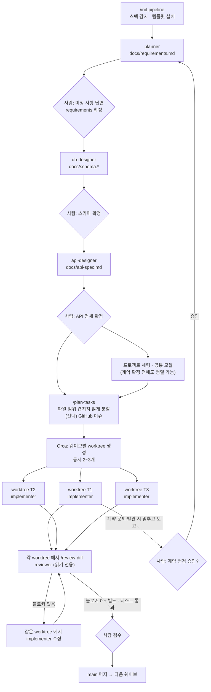

# dev-pipeline

여러 Claude Code 에이전트가 **병렬 worktree** 에서 동시에 개발할 때, 요구사항 · DB · 코드가 서로 어긋나지 않게 하는 파이프라인 플러그인입니다.

흐름은 한 줄로 이렇습니다: **계약 문서 먼저 확정 → 기능별 worktree 병렬 구현 → 별도 에이전트 리뷰 → 사람은 검수만.**

특정 언어 · 프레임워크 · DB 에 묶여 있지 않습니다. 프로젝트마다 스택을 감지하거나 사용자에게 고르게 해서 `CLAUDE.md` 에 기록하고, 모든 에이전트가 그 기록을 기준으로 움직입니다.

- 버전: 0.1.0
- 구성: 스킬 4 (사용자 실행 3 + 자동 규칙 1) · 에이전트 5 · 훅 1 · 템플릿 6
- worktree 생성과 에이전트 실행은 [Orca](#6-orca-와-함께-쓰는-전체-흐름) 에서 사용자가 직접 합니다. 이 플러그인은 문서, 작업 분할, 리뷰까지 맡습니다.

---

## 1. 해결하는 문제

에이전트 하나로 개발할 때는 요구사항 → DB → API → 코드를 한 머릿속(한 컨텍스트)에서 이어서 처리하니 크게 어긋나지 않습니다. 그런데 에이전트를 여러 개 동시에 돌리면:

| 증상 | 원인 |
| --- | --- |
| A 에이전트는 `user_id`, B 에이전트는 `userId` 로 같은 걸 만든다 | 서로 상대가 무엇을 정했는지 모른다 |
| 같은 설정 파일을 두 worktree 가 고쳐 머지가 충돌한다 | 작업을 나눌 때 파일 범위를 안 봤다 |
| 구현하던 에이전트가 편한 대로 API 를 바꾼다 | 기준 문서가 없거나, 있어도 고칠 수 있다 |
| "다 됐다" 는데 테스트가 없다 | 만든 사람이 스스로 검사한다 |

dev-pipeline 은 이것을 이렇게 막습니다.

1. **계약 문서**(requirements → schema → api-spec)를 구현 전에 사람이 확정합니다. 모든 구현은 이 문서를 기준으로 합니다.
2. 작업을 **파일 범위가 겹치지 않게** 나눕니다 (`/plan-tasks`). 겹치면 다시 나눕니다.
3. 에이전트마다 **쓸 수 있는 곳을 실제로 제한**합니다. 문서 담당은 `docs/` 만, 구현 담당은 `docs/` 를 못 고치고, 리뷰 담당은 아무것도 못 고칩니다.
4. 구현한 에이전트와 **다른 에이전트가 리뷰**합니다 (`/review-diff`).

## 2. 설치

```bash
claude plugin marketplace add HiSoo38/claude-toolkit
claude plugin install dev-pipeline@claude-toolkit
```

세션 안에서는 `/plugin marketplace add HiSoo38/claude-toolkit` → `/plugin install dev-pipeline@claude-toolkit`, 이미 열린 세션에는 `/reload-plugins`.

확인:

```bash
claude plugin details dev-pipeline
```

필요한 것:

- Claude Code
- `git` (`/review-diff`, worktree)
- `gh` CLI — `/plan-tasks` 에서 GitHub 이슈를 만들 때만
- Python 3 (`python3` 또는 `python`) — 쓰기 위치 제한 훅. 없으면 훅이 동작하지 않고 에이전트 프롬프트의 지시만 남습니다 ([FAQ](#9-faq--문제-해결))

환경변수나 비밀값은 필요 없습니다.

## 3. 빠른 시작

명령은 `/dev-pipeline:<이름>` 이 정식 이름입니다. 다른 플러그인과 이름이 겹치지 않으면 `/init-pipeline` 처럼 짧게 써도 됩니다.

### 새 프로젝트 (빈 폴더)

```text
1. 빈 폴더에서 Claude Code 실행
2. /dev-pipeline:init-pipeline
   → 감지할 파일이 없으니 언어 · 프레임워크 · DB · 빌드 도구를 선택지로 물어봄 (목록에 없으면 "기타" 로 직접 입력)
   → CLAUDE.md, AGENTS.md, docs/requirements.md, docs/schema.*, docs/api-spec.md 생성
3. "planner 에이전트로 요구사항 정리해줘: <만들 서비스 설명>"
4. docs/requirements.md 의 미정 사항에 답하고 상태를 "확정" 으로
5. "db-designer 로 스키마 만들어줘" → 검토·확정
6. "api-designer 로 API 명세 만들어줘" → 검토·확정
7. 프로젝트 골격(빌드 설정, 디렉터리)을 먼저 만들고 main 에 커밋 (implementer 또는 직접)
8. /dev-pipeline:plan-tasks → 작업 목록, 브랜치명, worktree 명령
9. Orca 에서 작업별 worktree 를 만들고 각각 implementer 실행
10. 각 worktree 에서 /dev-pipeline:review-diff → 블로커 0 이면 사람 검수 후 머지
```

### 기존 프로젝트

```text
1. 프로젝트 루트에서 /dev-pipeline:init-pipeline
   → build.gradle, package.json 등에서 스택을 감지해 근거 파일과 함께 보여주고 맞는지 확인
   → CLAUDE.md 가 이미 있으면 덮어쓰지 않고 "건너뛰기 / 빠진 섹션만 추가 / 덮어쓰기" 를 물어봄
2. 이미 있는 요구사항·DB 설계가 있으면 planner / db-designer 에게 그 내용을 주고 docs/ 로 옮겨 정리
3. 이후는 새 프로젝트 4번부터 같음
```

## 4. 커맨드

세 커맨드는 공식 문서 권장대로 **스킬**(`skills/<이름>/SKILL.md`)로 만들어져 있고, `disable-model-invocation: true` 라서 사용자가 직접 실행할 때만 동작합니다.

### `/dev-pipeline:init-pipeline [경로]`

스택을 감지하고 템플릿을 프로젝트에 설치합니다.

| 단계 | 하는 일 |
| --- | --- |
| 감지 | 언어 · 프레임워크 · 빌드 도구 · DB · 테스트 도구를 근거 파일(`build.gradle`, `pom.xml`, `package.json`, `requirements.txt`, `pyproject.toml`, `go.mod`, `Cargo.toml`, `application.yml/properties`, `.env.example`, `docker-compose.yml` 등)에서 찾고, 근거와 함께 표로 보여준 뒤 확인을 받음 |
| 선택 | 감지 실패나 빈 프로젝트면 항목별로 선택지를 물어봄 (기타 직접 입력 가능) |
| 복사 | `CLAUDE.md`, `AGENTS.md` → 루트 / `requirements.md`, 스키마, `api-spec.md` → `docs/`. 이미 있는 파일은 덮어쓰지 않고 물어봄 |
| 기록 | `CLAUDE.md` 의 "기술 스택", "빌드·테스트 명령", "패키지 구조", "계약 문서" 표를 채움. 모르는 칸은 `<!-- TODO -->` |
| 스키마 형식 | 관계형 DB → `docs/schema.sql` (해당 DB 의 DDL), 문서형 DB나 ORM 모델 중심 스택 → `docs/schema.md`, DB 없음 → 만들지 않음 |

`.env` 처럼 비밀값이 있을 수 있는 파일은 읽지 않습니다 (`.env.example` 만 읽음). 소스 코드와 git 상태는 건드리지 않습니다.

예:

```text
> /dev-pipeline:init-pipeline

| 항목 | 감지 값 | 근거 |
| 언어 | Java 17 | build.gradle: java.toolchain.languageVersion = 17 |
| 프레임워크 | Spring Boot | build.gradle: plugins { id 'org.springframework.boot' } |
| DB | PostgreSQL | application.yml: jdbc:postgresql:// |
...
이 감지 결과가 맞나요?  ① 맞음  ② 일부 수정  ③ 처음부터 직접 선택
```

### `/dev-pipeline:plan-tasks [추가 지시]`

`docs/` 계약 문서를 읽고 **파일 범위가 겹치지 않는** 기능 단위 작업으로 나눕니다.

- 작업마다: 제목, 담당 파일 범위, 완료 조건, 의존 관계(웨이브), 권장 브랜치명, worktree 생성 예시 명령
- 두 작업이 같은 파일을 건드리면 결과를 보여주지 않고 다시 나눕니다. 공유 파일(라우터 등록, 공통 설정 등)은 별도 "공통 모듈" 작업으로 떼어 먼저 하게 합니다
- 계약 문서가 "확정" 이 아니거나 미정 사항이 남아 있으면 경고하고 계속할지 묻습니다
- 끝에 GitHub 이슈로 만들지 묻고, 승인하면 `gh issue create` 로 만듭니다 (라벨·보드는 지정할 때만)

예:

```text
> /dev-pipeline:plan-tasks 동시 작업은 2개까지

### T1. 공통 모듈 — 에러 응답 · 인증 필터
- 웨이브: 1 (의존: 없음)
- 담당 파일 범위: src/.../common/**
- 권장 브랜치: feat/t1-common
- worktree 예시: git worktree add ../myapp-t1 -b feat/t1-common
### T2. 회원 가입 · 조회 (F-01, F-02)
- 웨이브: 2 (의존: T1)
...
이 작업들을 GitHub 이슈로 만들까요?
```

### `/dev-pipeline:review-diff [기준 브랜치]`

현재 브랜치와 기준 브랜치(기본 `main`, 없으면 `master`)의 diff 를 `dev-pipeline:reviewer` 에이전트에 넘겨 리뷰를 받습니다.

- 읽기 전용 git 명령(`diff`, `log`, `status` 등)만 씁니다
- 커밋 안 된 변경이 있으면 포함할지 묻습니다
- diff 가 크면 모듈 단위로 나눠 여러 번 리뷰하고 합칩니다
- 결과: **블로커 / 권장 / 사소함**, 판정(블로커 0 이면 통과)

```text
> /dev-pipeline:review-diff

## 리뷰 결과: feat/t2-member → main
판정: 수정 필요 (블로커 1)
### 블로커
1. src/.../MemberController.java:42 — 응답 필드 `userName` 이 api-spec 의 `name` 과 다름 ...
```

### 자동 규칙: `pipeline-workflow`

커맨드가 아니라, 기능 구현을 시작하거나 계약 문서를 바꾸려 할 때 Claude 가 스스로 불러오는 규칙 스킬입니다. 계약 확정 전 구현 금지, 작업 하나 = worktree 하나, 구현·리뷰 분리, 계약 변경은 사람 승인, 완료 조건 등을 담고 있습니다. `/dev-pipeline:pipeline-workflow` 로 직접 볼 수도 있습니다.

## 5. 에이전트

모든 에이전트는 시작할 때 프로젝트 `CLAUDE.md` 의 "기술 스택" 과 `docs/` 계약 문서를 읽고, 기술 스택이 비어 있으면 작업하지 않고 `/dev-pipeline:init-pipeline` 을 안내합니다.

| 에이전트 | 입력 → 출력 | 도구 (실제 허용 목록) | 쓰기 제한 (훅) |
| --- | --- | --- | --- |
| `planner` | 사용자 요구 → `docs/requirements.md` | Read, Glob, Grep, Write, Edit | `docs/` 밖 금지 |
| `db-designer` | requirements → `docs/` 스키마 | Read, Glob, Grep, Write, Edit | `docs/` 밖 금지 |
| `api-designer` | requirements + 스키마 → `docs/api-spec.md` | Read, Glob, Grep, Write, Edit | `docs/` 밖 금지 |
| `implementer` | 할당 작업 → 코드 + 테스트 | Read, Glob, Grep, Write, Edit, Bash | `docs/` 금지 |
| `reviewer` | diff → 블로커/권장/사소함 | Read, Glob, Grep | 전부 금지 |

문서 담당 세 에이전트에는 Bash 가 없어서 셸로 우회할 수 없습니다. implementer 는 빌드·테스트를 돌려야 해서 Bash 가 있으므로, `docs/` 보호는 Write/Edit 차단 + 프롬프트 지시입니다.

### 호출 예시 문장

```text
planner 에이전트로 요구사항 정리해줘. 동네 도서관 대출 관리 서비스고, 회원은 책을 검색하고 대출 · 반납 · 연장할 수 있어.
db-designer 에이전트로 docs/requirements.md 기준 스키마 만들어줘.
api-designer 에이전트로 API 명세 써줘.
implementer 에이전트로 T2 작업 해줘. 담당 파일 범위는 src/main/java/.../member/** 와 그 테스트야.
@agent-dev-pipeline:reviewer 이 브랜치 리뷰해줘   (보통은 /dev-pipeline:review-diff 를 씀)
```

`@agent-dev-pipeline:<이름>` 으로 직접 지목하면 확실하게 그 에이전트가 실행됩니다.

## 6. Orca 와 함께 쓰는 전체 흐름



Orca 에서 할 일 (이 플러그인은 하지 않음):

1. `/plan-tasks` 결과의 웨이브 1 작업마다 worktree 를 만듭니다 (출력된 `git worktree add ...` 명령 또는 Orca UI).
2. 각 worktree 에서 Claude Code 를 띄우고 "implementer 에이전트로 T<번호> 작업 해줘" 라고 지시합니다. 담당 파일 범위를 함께 붙여 넣습니다.
3. 완료 보고가 오면 그 worktree 에서 `/dev-pipeline:review-diff`.
4. 블로커 0 이면 사람이 검수하고 머지합니다. 웨이브 1 이 모두 머지되면 웨이브 2 로.

## 7. 스택 자동 감지와 수동 선택

- 감지 규칙과 선택지 목록은 프롬프트가 아니라 데이터 파일 [`skills/init-pipeline/stack-catalog.md`](./skills/init-pipeline/stack-catalog.md) 에 있습니다. 근거 파일 → 언어·빌드 도구, 의존성 이름 → 프레임워크·DB·테스트 도구, 스키마 형식 결정 규칙, 기본 빌드·테스트 명령이 표로 들어 있습니다.
- 감지 결과는 항상 **근거 파일과 함께** 보여주고 확인을 받습니다. 근거가 충돌하면(DB 드라이버가 둘 등) 둘 다 보여주고 고르게 합니다.
- **수동 선택**: 확인 질문에서 "일부 수정" 또는 "처음부터 직접 선택" 을 고르면 됩니다. 선택지에 없는 값은 "기타" 로 직접 입력합니다.
- **나중에 바꾸기**: `CLAUDE.md` 의 "기술 스택" 표를 직접 고치면 됩니다. 모든 에이전트는 매번 이 표를 읽습니다. 또는 `/dev-pipeline:init-pipeline` 을 다시 실행하면 기존 값과 다른 항목만 보여주고 어느 쪽을 쓸지 묻습니다.
- 에이전트·커맨드 프롬프트에는 특정 언어·프레임워크·DB 이름이 없습니다. 판단 기준은 언제나 프로젝트의 `CLAUDE.md` 입니다.

## 8. 커스터마이징

플러그인 파일을 직접 고치려면 레포를 클론해 로컬 마켓플레이스로 추가하세요 (`claude plugin marketplace add ./claude-toolkit`). 설치된 캐시 사본을 고치면 업데이트 때 사라집니다.

| 바꾸고 싶은 것 | 위치 |
| --- | --- |
| 프로젝트에 깔리는 문서 틀 | `templates/` (`CLAUDE.md`, `AGENTS.md`, `requirements.md`, `schema.sql`, `schema.md`, `api-spec.md`) |
| 지원 스택, 감지 규칙, 선택지, 기본 명령 | `skills/init-pipeline/stack-catalog.md` (표에 행 추가) |
| 커맨드 동작 | `skills/<init-pipeline \| plan-tasks \| review-diff>/SKILL.md` |
| 진행 규칙 | `skills/pipeline-workflow/SKILL.md` |
| 에이전트 역할 · 리뷰 관점 · 허용 도구 | `agents/<이름>.md` (frontmatter `tools`, 본문 프롬프트) |
| 쓰기 위치 제한 (`docs/` 이름, 대상 에이전트) | `hooks/guard_paths.py` 상단 상수 |

**한 프로젝트에서만** 다르게 하고 싶으면 플러그인을 고치지 말고:

- 그 프로젝트의 `CLAUDE.md` 에 규칙을 적습니다 (에이전트가 매번 읽음).
- 또는 에이전트 파일을 프로젝트 `.claude/agents/` 로 복사해 고칩니다. 복사본은 `planner` 처럼 접두사 없는 이름으로 따로 생기고(플러그인 쪽 `dev-pipeline:planner` 는 그대로), 호출할 때 그 이름을 지목하면 됩니다. 훅은 이름 끝부분으로 판단하므로 복사본에도 쓰기 제한이 그대로 적용됩니다.

## 9. FAQ / 문제 해결

**`/init-pipeline` 이 목록에 안 보여요.**
`claude plugin list` 에서 `dev-pipeline@claude-toolkit` 이 enabled 인지 보고, 열려 있던 세션이면 `/reload-plugins` 를 실행하세요. 다른 플러그인에 같은 이름이 있으면 짧은 이름 대신 `/dev-pipeline:init-pipeline` 을 씁니다.

**에이전트가 "먼저 /init-pipeline 을 실행하세요" 만 하고 끝나요.**
프로젝트 루트 `CLAUDE.md` 에 "기술 스택" 섹션이 없거나 값이 모두 `<!-- TODO -->` 인 경우입니다. `/dev-pipeline:init-pipeline` 을 실행하거나 표를 직접 채우세요.

**planner 가 `docs/` 밖에 쓰려다 막혔다고 나와요.**
의도된 동작입니다 (`hooks/guard_paths.py`). 문서 에이전트는 `docs/` 아래만 쓸 수 있습니다. 코드가 필요하면 implementer 에게 맡기세요.

**implementer 가 계약 문서를 고치지 못해 멈췄어요.**
의도된 동작입니다. 보고된 변경 제안을 검토하고, 승인하면 해당 문서 담당 에이전트(planner / db-designer / api-designer)에게 고치게 한 뒤 implementer 를 다시 실행하세요.

**쓰기 제한 훅이 동작하지 않는 것 같아요.**
- Python 3 가 `python3` 또는 `python` 으로 실행되는지 확인하세요. 훅은 `python3` 을 먼저 시도하고, 안 되면 `python` 을 씁니다.
- 훅 명령은 bash 문법입니다. Windows 에서는 Git Bash 가 설치돼 있어야 합니다 (Claude Code 가 Git Bash 로 훅을 실행).
- `claude --debug` 로 실행하면 훅 실행 로그를 볼 수 있습니다.
- 훅이 실패해도 작업을 막지는 않고 통과시킵니다(다른 작업을 멈추지 않기 위해). 이때는 에이전트 프롬프트의 지시만 남습니다.

**`/plan-tasks` 가 이슈를 못 만들어요.**
`gh auth status` 로 로그인 상태를, 현재 폴더가 GitHub 원격이 있는 git 저장소인지 확인하세요.

**`/review-diff` 가 "기준 브랜치가 없다" 고 해요.**
`main` 과 `master` 가 둘 다 없는 경우입니다. `/dev-pipeline:review-diff develop` 처럼 기준 브랜치를 넘기세요.

**계약 확정 전에 꼭 시작해야 하는 작업이 있어요.**
프로젝트 세팅(빌드 설정, 디렉터리 골격)과 공통 모듈은 계약 확정 전에도 병렬로 해도 됩니다. 기능 구현만 기다립니다.

**동시에 몇 개까지 돌려도 되나요?**
2~3개를 권장합니다. 그보다 많으면 사람 검수가 병목이 되고, 계약 변경이 생겼을 때 영향받는 작업이 늘어납니다.
